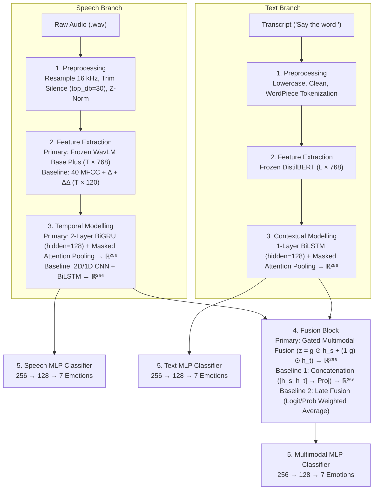

# PROJECT AUDIT — Assignment 2b: Multimodal Emotion Recognition

**Date:** 2026-11-18  
**Workspace:** `/Users/swaruppal/Downloads/Ass_2`  
**Stage:** STEP 01 — Complete Repository Audit (Pre-Implementation)  
**Implementation Status:** Not Started (Audit Only)

---

## 1. Project Overview

This repository contains materials for **Assignment 2**, which is divided into two distinct parts:

1. **Assignment 2a (`Assignment 2a/`):** Forced Alignment using the Montreal Forced Aligner (MFA) on a small provided speech dataset of 6 utterances (`F2BJRLP1`–`3` from the BU Radio News Corpus and `ISLE_SESS0131_BLOCKD02_01`–`03_sprt1`). Note: Inside `Assignment 2a/Assignment_2a.pdf`, this document is titled *"Assignment 1: Forced Alignment using Montreal Forced Aligner (MFA)"*. **Per strict project constraints, `Assignment 2a/` is completely untouched and read-only.**
2. **Assignment 2b (`Assignment 2b.pdf`):** **Multimodal Emotion Recognition** on the **Toronto Emotional Speech Set (TESS)**. The objective is to design, implement, evaluate, and analyze three emotion recognition pipelines:
   - **Pipeline A:** Speech-only emotion recognition.
   - **Pipeline B:** Text-only emotion recognition.
   - **Pipeline C:** Multimodal (Speech + Text) emotion recognition.

Currently, the repository contains **only** the assignment specification PDFs (`Assignment 2b.pdf` and `Assignment 2a/Assignment_2a.pdf`) and the raw audio/transcript files for Assignment 2a. **Zero Python source files, configuration files, datasets, or result artifacts exist yet for Assignment 2b.**

---

## 2. Existing Directory Structure

An exhaustive file inspection of `/Users/swaruppal/Downloads/Ass_2` prior to creating the audit documentation revealed the following structure:

```text
/Users/swaruppal/Downloads/Ass_2/
├── .DS_Store                                                  (8,196 bytes)
├── Assignment 2a/
│   ├── Assignment_2a.pdf                                      (68,596 bytes)
│   ├── transcripts/
│   │   ├── F2BJRLP1.TXT                                       (438 bytes)
│   │   ├── F2BJRLP2.TXT                                       (509 bytes)
│   │   ├── F2BJRLP3.TXT                                       (550 bytes)
│   │   ├── ISLE_SESS0131_BLOCKD02_01_sprt1.txt                (23 bytes)
│   │   ├── ISLE_SESS0131_BLOCKD02_02_sprt1.txt                (19 bytes)
│   │   └── ISLE_SESS0131_BLOCKD02_03_sprt1.txt                (20 bytes)
│   └── wav/
│       ├── F2BJRLP1.wav                                       (810,916 bytes — NIST SPHERE header, 16 kHz mono PCM)
│       ├── F2BJRLP2.wav                                       (917,742 bytes — NIST SPHERE header, 16 kHz mono PCM)
│       ├── F2BJRLP3.wav                                       (983,642 bytes — NIST SPHERE header, 16 kHz mono PCM)
│       ├── ISLE_SESS0131_BLOCKD02_01_sprt1.wav                (136,096 bytes — RIFF WAVE, 16-bit mono 16 kHz PCM)
│       ├── ISLE_SESS0131_BLOCKD02_02_sprt1.wav                (128,096 bytes — RIFF WAVE, 16-bit mono 16 kHz PCM)
│       └── ISLE_SESS0131_BLOCKD02_03_sprt1.wav                (148,096 bytes — RIFF WAVE, 16-bit mono 16 kHz PCM)
└── Assignment 2b.pdf                                          (200,390 bytes)
```

- **Git Repository Status:** Not initialized (`fatal: not a git repository`).
- **Python Files (`*.py`):** None (`0` files).

---

## 3. Assignment 2b Requirements

Based on a complete reading of `Assignment 2b.pdf` (pages 1–3), the requirements are as follows:

### 3.1. Three Required Pipelines
- **a) Speech-Only Pipeline:** Input is raw speech waveform $\rightarrow$ Preprocessing $\rightarrow$ Feature Extraction $\rightarrow$ Temporal Modelling $\rightarrow$ Classifier $\rightarrow$ Emotion Label.
- **b) Text-Only Pipeline:** Input is transcript text $\rightarrow$ Preprocessing $\rightarrow$ Feature Extraction $\rightarrow$ Contextual Modelling $\rightarrow$ Classifier $\rightarrow$ Emotion Label.
- **c) Multimodal (Speech & Text) Pipeline:** Parallel Speech and Text branches through Temporal/Contextual Modelling $\rightarrow$ Fusion Block $\rightarrow$ Classifier $\rightarrow$ Emotion Label.

### 3.2. Five Required Functional Blocks
1. **Preprocessing:**
   - **Speech:** Handle varying audio lengths and recording quality, select an appropriate sampling rate (16 kHz for WavLM/speech models), trim leading/trailing silence, and normalize amplitude.
   - **Text:** Clean and tokenize the transcript text corresponding to each audio recording.
2. **Feature Extraction:**
   - **Speech:** Extract frame-level acoustic/emotional cues of shape $(\text{time\_steps} \times \text{features})$.
   - **Text:** Extract token-level lexical/emotional representations of shape $(\text{tokens} \times \text{features})$.
3. **Temporal / Contextual Modelling:**
   - **Speech (Temporal Modelling):** Learn emotional patterns and prosodic dynamics over time across frame sequences.
   - **Text (Contextual Modelling):** Learn emotional meaning across tokens in context.
4. **Fusion (Multimodal Only):**
   - Combine learned representations from both modalities (Speech & Text) into a unified multimodal representation for emotion classification.
5. **Classifier:**
   - Predict the discrete emotion label (7 classes in TESS) from the learned representation produced by the preceding block.

### 3.3. Required Deliverables Structure
`Assignment 2b.pdf` specifies the following layout:

```text
project/
├── models/
│   ├── speech_pipeline/
│   │   ├── train.py
│   │   └── test.py
│   ├── text_pipeline/
│   │   ├── train.py
│   │   └── test.py
│   └── fusion_pipeline/
│       ├── train.py
│       └── test.py
├── Results/
│   ├── All 3 model variants accuracy tables
│   └── plots/
├── README.md
└── requirements.txt
```

### 3.4. Required Experimental Comparisons, Tables, Plots, Error Analysis & Visualizations
1. **Architecture Decisions (Report Section A):**
   - Justification of chosen ML/DL architecture for every functional block (what architecture was chosen and why).
2. **Experimental Comparisons & Tables (Report Section B & `Results/`):**
   - Quantitative comparison across **Speech-only**, **Text-only**, and **Multimodal** variants (including baselines and ablations).
   - Accuracy tables (along with Precision, Recall, Macro-F1 across 3 random seeds and evaluation protocols).
3. **In-Depth Analysis (Report Section C & `Results/plots/`):**
   - **Per-emotion performance analysis:** Identify which emotions are easiest and hardest to classify, with acoustic/linguistic explanations and confusion matrices.
   - **Modality utility analysis:** Analyze when multimodal fusion helps most (and how gated fusion behaves when text is lexically neutral or conflicting).
   - **Concrete error analysis:** Detailed inspection of **3–5 specific failure cases** (file ID, ground truth, predicted probabilities across pipelines, acoustic/textual cause of error).
   - **Embedding cluster separability visualizations (t-SNE / UMAP):** Visualize and compare the separability of the 7 emotion clusters using learned representations extracted specifically from:
     1. The **Temporal Modelling block** (Speech-only).
     2. The **Contextual Modelling block** (Text-only).
     3. The **Fusion block** (Multimodal).
4. **Public GitHub Repository:** Scripts, setup instructions, report, and results organized for reproducible evaluation.

---

## 4. Existing Datasets and Files

### 4.1. Assignment 2a Files (Read-Only, For MFA Assignment)
- `Assignment 2a/Assignment_2a.pdf`: 3-page PDF specifying Montreal Forced Aligner (MFA) setup and alignment tasks.
- `Assignment 2a/wav/F2BJRLP1.wav`, `F2BJRLP2.wav`, `F2BJRLP3.wav`: Boston University (BU) Radio News Corpus recordings (`speaker_id: f2b`, 16 kHz, 16-bit mono PCM encapsulated in **NIST SPHERE (`NIST_1A`)** headers rather than standard RIFF headers).
- `Assignment 2a/wav/ISLE_SESS0131_BLOCKD02_01_sprt1.wav` to `03_sprt1.wav`: Short contrast utterances (`"I SAID WHITE NOT BAIT"`, `"I SAID NEW NOT NO"`, `"I SAID BAD NOT BED"`) in standard **RIFF WAVE** 16 kHz 16-bit mono PCM format.
- `Assignment 2a/transcripts/`: Corresponding plain-text transcripts for the 6 audio files above.

### 4.2. Assignment 2b Dataset Status (TESS)
- **TESS Dataset Availability:** **NOT PRESENT.**
- A system-wide search across `/Users/swaruppal/Downloads`, `/Users/swaruppal/Documents`, `/Users/swaruppal/Desktop`, and `~/.cache` confirmed that the **Toronto Emotional Speech Set (TESS)** has **not** yet been downloaded to this machine.
- `Assignment 2b.pdf` links directly to: `https://www.kaggle.com/datasets/ejlok1/toronto-emotional-speech-set-tess`.
- Note: `~/.kaggle/kaggle.json` and `~/.kaggle/access_token` **do exist** on the system (created May 16, 2026), which will facilitate authenticated downloading via `kaggle` / `kagglehub` once approved in the dataset setup stage.

---

## 5. Missing Components

Everything required for Assignment 2b must be built from scratch:

1. **Dataset & Manifest Infrastructure:**
   - Local TESS dataset directory (`data/tess/` or configurable path).
   - Deduplicated metadata manifest generator (parsing speaker, target word, canonical emotion label, transcript `"Say the word <word>"`, audio duration, and sampling rate).
   - Deterministic **Word-Independent Split** (70% train / 15% val / 15% test over the 200 unique target words) and **Cross-Speaker Split** (`OAF` $\rightarrow$ `YAF`).
2. **Environment & Dependencies (`requirements.txt`):**
   - Clean, working Python environment with compatible `numpy`, `scipy`, `scikit-learn`, `pandas`, `matplotlib`, `seaborn`, `torch`, `torchaudio`, `transformers`, `librosa`, `soundfile`, `tqdm`.
3. **Preprocessing & Feature Caching Modules:**
   - Speech preprocessing (resampling to 16 kHz, silence trimming, peak/z-score normalization) and offline/disk feature caching for **WavLM Base Plus** (`microsoft/wavlm-base-plus`) and **MFCC** (40-dim MFCC + $\Delta$ + $\Delta\Delta$).
   - Text preprocessing and **DistilBERT** (`distilbert-base-uncased`) token embedding extraction/caching.
4. **Required Deliverable Pipeline Scripts:**
   - `models/speech_pipeline/train.py` & `models/speech_pipeline/test.py` (WavLM + BiGRU + Attention Pooling + MLP, plus MFCC + CNN-BiLSTM baseline).
   - `models/text_pipeline/train.py` & `models/text_pipeline/test.py` (DistilBERT + BiLSTM + Attention Pooling + MLP).
   - `models/fusion_pipeline/train.py` & `models/fusion_pipeline/test.py` (Gated bimodal fusion, plus Concatenation and Late Fusion baselines).
5. **Evaluation, Visualization & Reporting (`Results/`, `README.md`):**
   - Multi-seed (3 seeds) evaluation tables (`Results/`).
   - Confusion matrices, training curves, gating weight distributions, 3–5 failure case breakdown, and t-SNE/UMAP cluster separability plots for Temporal, Contextual, and Fusion blocks (`Results/plots/`).
   - Comprehensive technical report and `README.md`.

---

## 6. Existing Dependencies

An inspection of all Python environments on the machine revealed the following state:

| Environment Path | Python Version | `torch` | `torchaudio` | `transformers` | `librosa` / `soundfile` | `scipy` / `sklearn` / `pandas` / `matplotlib` | Status / Issues |
| :--- | :--- | :--- | :--- | :--- | :--- | :--- | :--- |
| **`/opt/anaconda3` (`base`, default)** | 3.12.7 | 2.10.0 | Missing | Missing | Missing | Installed (`scipy` 1.13.1, `sklearn` 1.5.1, `pandas` 2.2.2, `matplotlib` 3.9.2), **BROKEN** | **CRITICAL:** `numpy 2.2.6` breaks `scipy`, `sklearn`, `pandas`, `pyarrow`, `matplotlib`, `seaborn` (`ImportError: A module that was compiled using NumPy 1.x cannot be run in NumPy 2.2.6`). |
| `/opt/anaconda3/envs/researchVenv` | 3.12.13 | 2.13.0 | Missing | 5.15.0 | Missing | `scipy` 1.18.0, `sklearn` 1.9.0 (`pandas`/`matplotlib` missing) | Functional `torch` + `transformers` on MPS, but lacks audio & plotting libraries. |
| `/opt/anaconda3/envs/mfa_env` | 3.10.22 | Missing | Missing | Missing | `librosa` 0.11.0, `soundfile` 0.14.0 | `scipy` 1.15.2, `sklearn` 1.7.2, `matplotlib` 3.10.9 | Created for Assignment 2a (MFA); lacks `torch` and `transformers`. |
| `/opt/anaconda3/envs/torch_m2` | 3.10.19 | 2.10.0 | 2.10.0 | Missing | Missing | Missing | Minimal PyTorch + Torchaudio env. |
| `/opt/anaconda3/envs/ragvenv` | 3.11.15 | 2.13.0 | Missing | 5.14.1 | Missing | `scipy` 1.17.1, `sklearn` 1.9.0 | Missing audio, pandas, and plotting packages. |

**Additional System Tools:**
- `uv`: Installed at `/opt/homebrew/bin/uv`.
- `ffmpeg`: Installed at `/opt/homebrew/bin/ffmpeg`.
- HuggingFace Hub Cache (`~/.cache/huggingface/hub`): Exists, but **neither `microsoft/wavlm-base-plus` nor `distilbert-base-uncased` is cached locally yet**.

---

## 7. Hardware and Environment Details

- **Processor:** Apple M2 (ARM64 / Apple Silicon).
- **System Memory (Unified RAM):** **8.0 GB** (`8,589,934,592` bytes).
- **Operating System:** macOS 27.0.1 (Build `26A434`).
- **Disk Space Available:** ~31 GB free on `/System/Volumes/Data` (228 GB total, 85% used).
- **Hardware Acceleration:**
  - **CUDA:** `False` (Not applicable on macOS).
  - **Apple Metal Performance Shaders (MPS):** `True` (`torch.backends.mps.is_available() == True`, `torch.backends.mps.is_built() == True`).
  - **MPS Verification:** Empirically verified during audit that `nn.GRU` (bidirectional), `nn.LSTM` (bidirectional), `pack_padded_sequence`, `WavLMModel` (with `feat_extract_norm="layer"`), and `DistilBertModel` execute forward/backward passes on `mps` without error.

---

## 8. Proposed Architecture

The proposed system fulfills all five functional blocks across the three required pipelines while respecting the 8 GB unified memory envelope of the Apple M2 hardware:



### 8.1. Pipeline A: Speech-Only Emotion Recognition
1. **Preprocessing:** Load `.wav` audio, convert to mono float32, resample from native 24,414 Hz to **16,000 Hz**, trim leading/trailing silence (`librosa.effects.trim(top_db=30)`), and apply zero-mean unit-variance waveform normalization. Pad/truncate to a consistent maximum duration (e.g., 3.0 seconds = 48,000 samples, covering >99% of TESS utterances which average ~1.5–2.5s).
2. **Feature Extraction:**
   - **Primary (`WavLM Base Plus`):** Pass normalized 16 kHz waveform through frozen `microsoft/wavlm-base-plus` to extract frame-level contextualized acoustic representations $\mathbf{X}_s \in \mathbb{R}^{T_s \times 768}$ (or weighted layer-sum / last hidden state, cached to disk per utterance with valid frame lengths).
   - **Baseline (`MFCC`):** Extract 40 MFCCs + $\Delta$ + $\Delta\Delta$ ($120$ features per frame, 25 ms window, 10 ms hop) $\mathbf{X}_{\text{mfcc}} \in \mathbb{R}^{T_m \times 120}$ with per-utterance CMVN.
3. **Temporal Modelling:**
   - **Primary (`BiGRU + Masked Attention Pooling`):** Linear projection $768 \rightarrow 256$ with LayerNorm & Dropout, followed by a 2-layer Bidirectional GRU (`hidden_size=128`, producing $\mathbf{H}_s \in \mathbb{R}^{T_s \times 256}$), and a learnable **Masked Additive Self-Attention Pooling** layer that computes frame importance weights $\alpha_t$ (masking padded frames) to yield utterance embedding $\mathbf{h}_s \in \mathbb{R}^{256}$.
   - **Baseline (`CNN-BiLSTM`):** 1D convolutional front-end (2 Conv1D blocks with BatchNorm, ReLU, MaxPool) over the 120-dim MFCC sequence followed by a Bidirectional LSTM (`hidden_size=128`) and masked attention pooling $\rightarrow \mathbf{h}_{s,\text{base}} \in \mathbb{R}^{256}$.
4. **Classifier:** 2-layer MLP (`Linear(256, 128) -> LayerNorm -> GELU -> Dropout(0.3) -> Linear(128, 7)`).

### 8.2. Pipeline B: Text-Only Emotion Recognition
1. **Preprocessing:** Extract canonical target word from TESS metadata, construct normalized transcript `"say the word <word>"`, and tokenize via `DistilBertTokenizerFast` with attention masks.
2. **Feature Extraction:** Pass token IDs and attention mask through frozen `distilbert-base-uncased` to extract contextual token embeddings $\mathbf{X}_t \in \mathbb{R}^{L \times 768}$.
3. **Contextual Modelling:** Project $768 \rightarrow 256$, pass through a 1-layer Bidirectional LSTM (`hidden_size=128`, output $\mathbf{H}_t \in \mathbb{R}^{L \times 256}$), and apply **Masked Attention Pooling** over non-padding tokens to obtain contextual text embedding $\mathbf{h}_t \in \mathbb{R}^{256}$.
4. **Classifier:** 2-layer MLP (`Linear(256, 128) -> LayerNorm -> GELU -> Dropout(0.3) -> Linear(128, 7)`).

### 8.3. Pipeline C: Multimodal Speech + Text Emotion Recognition
1. **Modality Encoders:** Obtain temporal speech representation $\mathbf{h}_s \in \mathbb{R}^{256}$ and contextual text representation $\mathbf{h}_t \in \mathbb{R}^{256}$ from the respective branches.
2. **Fusion Block (3 Variants):**
   - **Primary — Gated Multimodal Fusion:**
     $$\tilde{\mathbf{h}}_s = \tanh(\mathbf{W}_s \mathbf{h}_s + \mathbf{b}_s), \quad \tilde{\mathbf{h}}_t = \tanh(\mathbf{W}_t \mathbf{h}_t + \mathbf{b}_t)$$
     $$\mathbf{g} = \sigma(\mathbf{W}_g [\mathbf{h}_s \,\|\, \mathbf{h}_t] + \mathbf{b}_g) \in (0, 1)^{256}$$
     $$\mathbf{h}_{\text{fusion}} = \mathbf{g} \odot \tilde{\mathbf{h}}_s + (\mathbf{1} - \mathbf{g}) \odot \tilde{\mathbf{h}}_t \in \mathbb{R}^{256}$$
     *Why Gated Fusion excels on TESS:* Because every target word in TESS appears in all 7 emotions inside the neutral carrier phrase `"Say the word <word>"`, lexical identity is orthogonal to the acted emotion ($I(\text{Text}; \text{Emotion}) = 0$) and emotionally loaded words (e.g., `"hate"` spoken happily) create modality conflict. The learnable gate $\mathbf{g}$ dynamically suppresses noisy/uninformative lexical dimensions and prioritizes acoustic prosody.
   - **Baseline 1 — Feature Concatenation:** Concatenate $[\mathbf{h}_s \,\|\, \mathbf{h}_t] \in \mathbb{R}^{512}$ followed by a linear projection + LayerNorm + GELU + Dropout $\rightarrow \mathbf{h}_{\text{concat}} \in \mathbb{R}^{256}$.
   - **Baseline 2 — Late (Decision-Level) Fusion:** Combine predicted probability distributions/logits from trained Speech-only and Text-only classifiers via learned/validated temperature-scaled weighting $\mathbf{p}_{\text{late}} = \lambda \mathbf{p}_s + (1 - \lambda) \mathbf{p}_t$.
3. **Classifier:** 2-layer MLP (`Linear(256, 128) -> LayerNorm -> GELU -> Dropout(0.3) -> Linear(128, 7)`).

### 8.4. Evaluation Protocol
- **Primary Split — Word-Independent Split:** Partition the 200 unique target words into disjoint Train (140 words = 1,960 samples), Validation (30 words = 420 samples), and Test (30 words = 420 samples) sets. All 7 emotions and both speakers (`OAF`, `YAF`) for a given word belong strictly to the same split, eliminating lexical memorization and word-level leakage.
- **Secondary Split — Cross-Speaker Generalization (`OAF` $\rightarrow$ `YAF`):** Train/validate on Older Actress (`OAF`, 1,400 samples) and evaluate zero-shot cross-speaker transfer on Younger Actress (`YAF`, 1,400 samples).
- **Statistical Rigor:** Run all trainable models across **3 random seeds (`42`, `123`, `999`)**, reporting `Mean ± Std` for **Accuracy**, **Macro-Precision**, **Macro-Recall**, and **Macro-F1**.

---

## 9. Identified Technical Risks & Mitigations

| # | Risk Category | Detailed Description | Severity | Mitigation Strategy |
| :- | :--- | :--- | :--- | :--- |
| **R1** | **Dataset Availability** | TESS is not currently present in the workspace or anywhere on the local disk. | **High** | Use authenticated Kaggle download (`ejlok1/toronto-emotional-speech-set-tess` via existing `~/.kaggle/kaggle.json`) or user-provided archive in Step 02, verifying exact file count (2,800 unique `.wav` files). |
| **R2** | **Kaggle TESS Duplicate Subfolder Bug** | The Kaggle `ejlok1/toronto-emotional-speech-set-tess` archive contains `TESS Toronto emotional speech set data/` AND a nested copy `TESS Toronto emotional speech set data/TESS Toronto emotional speech set data/` (5,600 `.wav` files total instead of 2,800). Naive `rglob("*.wav")` doubles the dataset and leaks identical audio files across splits. | **Critical** | Deduplicate discovered `.wav` files by canonical `(speaker, word, emotion)` key and SHA-256 / normalized filename (`basename.lower()`), asserting exactly **2,800 unique utterances** (2 speakers × 200 words × 7 emotions) before splitting. |
| **R3** | **TESS Filename & Folder Naming Inconsistencies** | Folder names vary in case and suffix (`OAF_Fear` vs `YAF_fear`, `OAF_Sad` vs `YAF_sad`, `OAF_Pleasant_surprise` vs `YAF_pleasant_surprised`), while filenames use `_ps.wav` for `pleasant_surprise` and occasional irregular spacing/casing (e.g., `YAF_germ_angry.wav` vs `OAF_happy` files). | **High** | Implement a strict, tested filename/folder parser with explicit mapping dictionary (`angry`, `disgust`, `fear`, `happy`, `neutral`, `ps`/`pleasant_surprise`/`pleasant_surprised` $\rightarrow$ `pleasant_surprise`, `sad`) and cross-verify folder label vs filename label for all 2,800 files. |
| **R4** | **Text Modality Degeneracy & Word Leakage in TESS** | Every one of the 200 target words is spoken once in each of the 7 emotions by each speaker. In a naive random split, holding out 1–2 emotions of a word into the test set causes a text model that memorizes words to predict only the training emotions (scoring *worse than random chance*, <14.29%). Even in a word-independent split, text alone carries zero mutual information with the acted emotion (~14.29% chance accuracy). | **High** | Enforce a strict **Word-Independent Split** so test words are unseen during training; document the information-theoretic bound ($1/7 \approx 14.29\%$) of text-only classification on TESS and highlight how Gated Fusion learns $\mathbf{g} \rightarrow \mathbf{1}$ (favoring speech over uninformative text) compared to unregularized concatenation. |
| **R5** | **Broken Base Conda Environment (`numpy 2.2.6` ABI Mismatch)** | The default `/opt/anaconda3` (`base`) Python 3.12 environment has `numpy 2.2.6` installed alongside `scipy 1.13.1`, `scikit-learn 1.5.1`, `pandas 2.2.2`, and `matplotlib 3.9.2` compiled against NumPy 1.x, causing immediate `ImportError` crashes on import. Furthermore, `torchaudio`, `transformers`, `librosa`, and `soundfile` are missing in `base`. | **Critical** | Create/configure a clean isolated project virtual environment (e.g. `.venv` via `uv` or conda) with pinned compatible versions (`numpy<2.0` or matching wheels, `torch`, `torchaudio`, `transformers`, `librosa`, `soundfile`, `scikit-learn`, `pandas`, `matplotlib`, `seaborn`, `umap-learn`). |
| **R6** | **Audio Sampling Rate & Format Compatibility** | TESS audio files are recorded at **24,414 Hz** (or 24 kHz) mono PCM, whereas `microsoft/wavlm-base-plus` strictly requires **16,000 Hz** input. (Also note: Assignment 2a's `F2BJRLP*.wav` files are NIST SPHERE files, though TESS uses RIFF WAVE). | **Medium** | Use `soundfile` / `librosa` to load audio, verify header integrity across all 2,800 TESS files, and explicitly resample every waveform to `16,000 Hz` before WavLM extraction. |
| **R7** | **8 GB Apple M2 Memory Limits & Feature Caching** | Running `WavLM Base Plus` (94.7M params) + `DistilBERT` (66M params) end-to-end during 3-seed training across multiple architectures on an 8 GB M2 Mac will be slow and risk memory swap/OOM. | **High** | Pre-extract and cache frozen `WavLM Base Plus` frame sequences (fp16/fp32 `.pt`/`.npz`), `MFCC` sequences, and `DistilBERT` token sequences to disk once. Training the downstream BiGRU/BiLSTM/Fusion models on cached sequences takes seconds per epoch and uses <500 MB RAM. |
| **R8** | **Pretrained Model Download & Offline Reproducibility** | Neither `microsoft/wavlm-base-plus` (~380 MB) nor `distilbert-base-uncased` (~268 MB) is currently in `~/.cache/huggingface/hub`. | **Medium** | Download and verify both HuggingFace checkpoints during the environment/data preparation stage prior to feature extraction. |

---

## 10. Recommended Implementation Roadmap

To ensure modularity, zero data leakage, and full verification at each stage, we recommend the following staged execution plan:

- **STEP 01: Complete Repository Audit (COMPLETED)**
  - Inspect directory tree, PDFs, hardware, environments, and technical risks.
  - Create `PROJECT_AUDIT.md`, `docs/IMPLEMENTATION_LOG.md`, and `docs/TESTING_REPORT.md`.
- **STEP 02: Environment Setup & TESS Dataset Acquisition / Verification**
  - Set up a clean, reproducible Python environment (`.venv`) and `requirements.txt` resolving the NumPy ABI issue and installing `torch`, `torchaudio`, `transformers`, `librosa`, `soundfile`, `scikit-learn`, `pandas`, `matplotlib`, `seaborn`.
  - Download/locate the TESS dataset (`ejlok1/toronto-emotional-speech-set-tess`), deduplicate the nested folder structure to exactly **2,800 unique `.wav` files**, validate audio headers, and generate the master metadata manifest (`data/tess_manifest.csv`) with deterministic **Word-Independent** (70/15/15) and **Cross-Speaker (`OAF` $\rightarrow$ `YAF`)** splits.
- **STEP 03: Preprocessing & Offline Feature Extraction / Caching**
  - Implement shared audio/text preprocessing utilities (16 kHz resampling, silence trimming, waveform normalization, transcript formatting).
  - Extract and cache frame-level features for **WavLM Base Plus** (`microsoft/wavlm-base-plus`), **MFCC (120-dim with $\Delta, \Delta\Delta$)**, and token-level features for **DistilBERT** (`distilbert-base-uncased`).
- **STEP 04: Speech-Only Pipeline (`models/speech_pipeline/`)**
  - Implement `train.py` and `test.py` for the primary **WavLM + BiGRU + Masked Attention Pooling + MLP** model and the **MFCC + CNN-BiLSTM** baseline.
  - Train and evaluate across 3 seeds (`42`, `123`, `999`) on both Word-Independent and Cross-Speaker (`OAF` $\rightarrow$ `YAF`) splits; export temporal embeddings.
- **STEP 05: Text-Only Pipeline (`models/text_pipeline/`)**
  - Implement `train.py` and `test.py` for **DistilBERT + BiLSTM + Masked Attention Pooling + MLP**.
  - Train and evaluate across 3 seeds on both splits; export contextual embeddings and verify theoretical behavior on TESS transcripts.
- **STEP 06: Multimodal Fusion Pipeline (`models/fusion_pipeline/`)**
  - Implement `train.py` and `test.py` for **Gated Multimodal Fusion** alongside **Concatenation** and **Late Fusion** baselines.
  - Train and evaluate across 3 seeds on both splits; export fused embeddings and analyze learned gate activations $\mathbf{g}$.
- **STEP 07: Results Aggregation, Visualizations, Error Analysis & Documentation**
  - Generate comprehensive accuracy/precision/recall/macro-F1 tables in `Results/`.
  - Generate confusion matrices, training curves, gate distribution plots, and 3-panel t-SNE/UMAP cluster separability visualizations (Temporal vs. Contextual vs. Fusion blocks) in `Results/plots/`.
  - Perform detailed error analysis on 3–5 concrete failure cases and finalize `README.md` and the Assignment 2b technical report.
