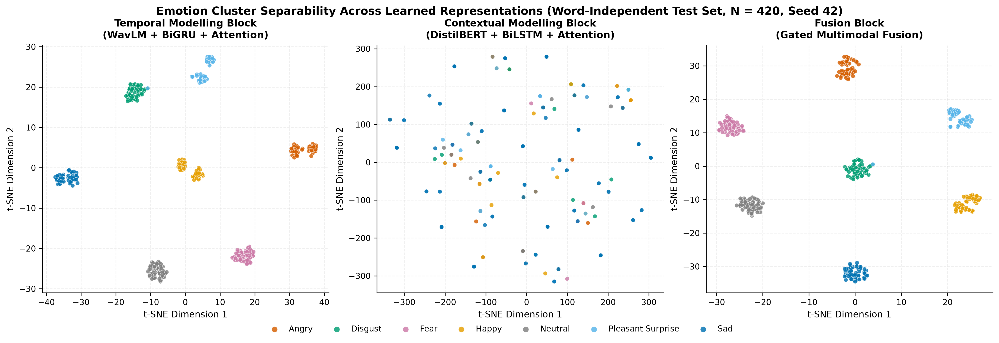
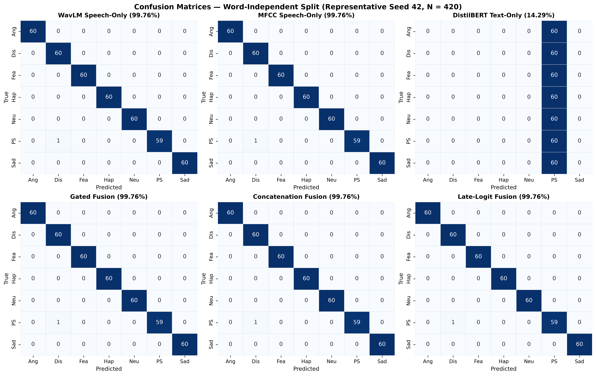
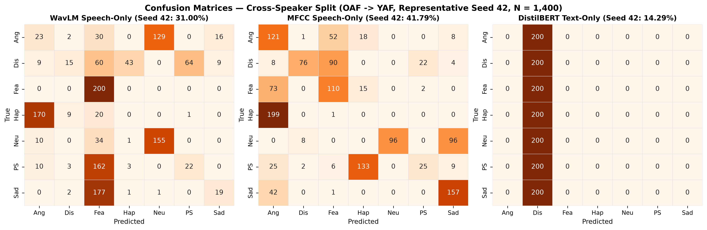
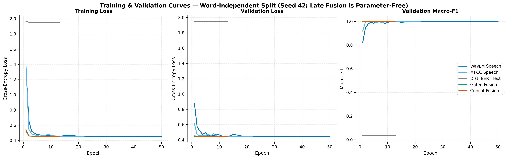
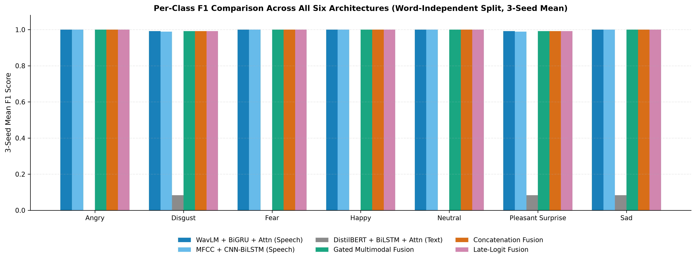
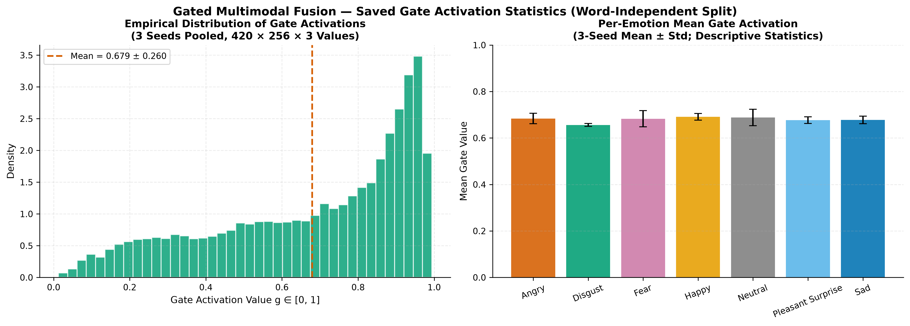
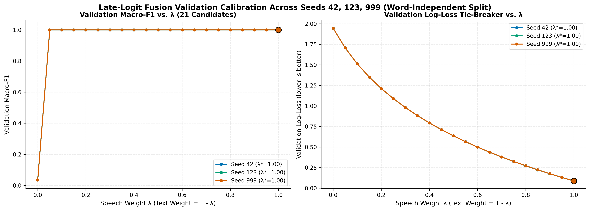
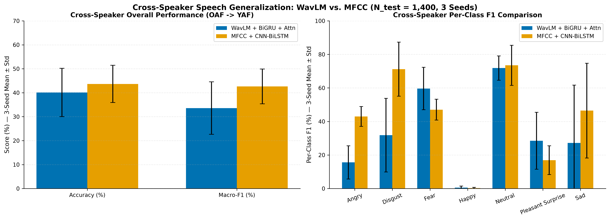
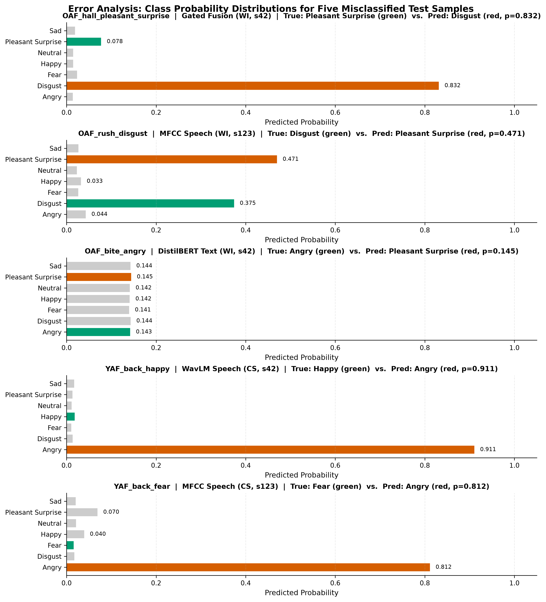

# Assignment 2B — Multimodal Emotion Recognition on the Toronto Emotional Speech Set (TESS)

**Course / Assignment:** IIITH Speech Processing — Assignment 2B (Multimodal Emotion Recognition)
**Dataset:** Toronto Emotional Speech Set (TESS) (`ejlok1/toronto-emotional-speech-set-tess`)
**Repository:** `https://github.com/Swarup72/Assignment_2_Speech`
**Completed Experimental Matrix:** 27 Frozen Experiments (12 Speech-Only, 6 Text-Only, 9 Multimodal Fusion)

---

## Abstract

This report presents the design, implementation, and experimental evaluation of a three-pipeline emotion recognition system—**Speech-Only**, **Text-Only**, and **Multimodal (Speech + Text) Fusion**—on the Toronto Emotional Speech Set (TESS), comprising 2,800 canonical utterances spoken by two female actors (`OAF` and `YAF`) across seven discrete emotions. Following the five-block modular specification (Preprocessing, Feature Extraction, Temporal/Contextual Modelling, Fusion, and Classification), we compare two acoustic encoders (**WavLM Base Plus + BiGRU + Masked Attention** and **MFCC + CNN-BiLSTM + Masked Attention**), one contextual text encoder (**DistilBERT + BiLSTM + Masked Attention**), and three multimodal fusion paradigms built on frozen unimodal encoders (**Gated Multimodal Fusion**, **Feature Concatenation Fusion**, and parameter-free **Late-Logit Fusion**). All experiments are evaluated across three random seeds (`42`, `123`, `999`) under a strict **word-independent split** (30 unseen test words, 420 test samples) and, for unimodal baselines, an additional **cross-speaker split** (`OAF` $\rightarrow$ `YAF`, 1,400 test samples). On the word-independent split, WavLM speech-only achieves **99.76 ± 0.00%** Accuracy and Macro-F1 (MFCC: **99.68 ± 0.14%**), whereas DistilBERT text-only achieves exact chance-level accuracy (**14.29 ± 0.00%**, Macro-F1 **3.57 ± 0.00%**) due to TESS's identical neutral carrier phrase (`"Say the word <word>"`). All three multimodal fusion models successfully preserve acoustic accuracy at **99.76 ± 0.00%** without degrading under uninformative text inputs, while cross-speaker unimodal evaluation exposes substantial domain shift (WavLM **40.12 ± 10.07%** Accuracy, MFCC **43.67 ± 7.78%** Accuracy).

---

## 1. Introduction

Automatic Emotion Recognition (AER) aims to classify a speaker's affective state from spoken utterances. Human emotional expression manifests through both **acoustic prosody** (pitch contours, energy dynamics, speaking rate, spectral timbre) and **lexical semantics** (word choice and syntactic context). Combining both modalities in a unified multimodal architecture is valuable when complementary cues exist, yet real-world datasets frequently exhibit modality imbalance or lexical neutrality.

This project implements all three required pipelines from the Assignment 2B specification:
1. **Speech-Only Pipeline:** Raw waveform $\rightarrow$ Preprocessing $\rightarrow$ Feature Extraction $\rightarrow$ Temporal Modelling $\rightarrow$ Classifier.
2. **Text-Only Pipeline:** Utterance transcript $\rightarrow$ Preprocessing $\rightarrow$ Feature Extraction $\rightarrow$ Contextual Modelling $\rightarrow$ Classifier.
3. **Multimodal (Speech & Text) Pipeline:** Parallel Speech and Text branches through Temporal and Contextual Modelling $\rightarrow$ Fusion Block $\rightarrow$ Classifier.

The scope covers end-to-end dataset verification and deduplication, offline feature caching, multi-seed training and evaluation across 27 frozen experiments, three-panel representation separability visualization, and concrete failure-case analysis.

---

## 2. Dataset Description

The **Toronto Emotional Speech Set (TESS)** contains emotional speech recordings of 200 English target words embedded in the fixed carrier phrase `"Say the word <word>"`, spoken by two actresses: an older female (`OAF`, 64 years old) and a younger female (`YAF`, 26 years old).

Verification of the canonical deduplicated manifest ([data/tess_manifest.csv](../data/tess_manifest.csv)) confirms:
- **Total Canonical Utterances:** **2,800** (`1,400` OAF, `1,400` YAF).
- **Unique Target Words:** **200** (each spoken once per emotion per speaker).
- **Class Distribution (Balanced across 7 Emotions):**
  - `0: angry` (400), `1: disgust` (400), `2: fear` (400), `3: happy` (400), `4: neutral` (400), `5: pleasant_surprise` (400), `6: sad` (400).
- **Real-World Irregularities Resolved in `src/data/build_manifest.py`:**
  1. **Duplicate Nested Directory:** Raw Kaggle download contains 5,600 `.wav` files (2,800 unique + 2,800 byte-identical nested duplicates verified via SHA-256). Deduplication retains exactly 2,800 canonical entries without modifying raw files.
  2. **Naming Normalization:** Folder/filename variants (`OAF_Fear`/`YAF_fear`, `OAF_Pleasant_surprise`/`YAF_pleasant_surprised`/`_ps.wav`, and speaker typo `OA_bite_neutral.wav`) are normalized to canonical `sample_id = "{speaker}_{word}_{emotion}"`.
  3. **Sampling Rate Outlier:** 2,799 recordings are sampled at 24,414 Hz while 1 file (`OAF_Fear/OAF_food_fear.wav`) is sampled at 96,000 Hz.

**Neutral Transcript Property:** Because every target word appears identically across all 7 emotions and both speakers in the carrier phrase `"Say the word <word>"`, transcript text is statistically independent of the acted emotion ($I(\text{Text}; \text{Emotion}) = 0$). Consequently, TESS provides an ideal controlled stress test for evaluating whether multimodal fusion mechanisms can suppress uninformative lexical inputs without degrading acoustic performance—while also limiting lexical diversity and real-world speaker generalization (only two studio-recorded speakers).

---

## 3. Data Preprocessing

Implemented in [src/features/speech_preprocessing.py](../src/features/speech_preprocessing.py) and verified against the codebase:
1. **Audio Loading & Mono Conversion:** Waveforms are read at native sampling rate via `soundfile` / `librosa` and converted to single-channel `float32` mono.
2. **Dynamic Resampling to 16 kHz:** Every waveform (including the 24,414 Hz files and the 96,000 Hz outlier) is resampled to **16,000 Hz** to satisfy `microsoft/wavlm-base-plus` input requirements and standardize acoustic frame geometry.
3. **Silence Trimming:** Leading and trailing silence is removed via `librosa.effects.trim` (`top_db=30.0`, `frame_length=512`, `hop_length=128`), with an automatic fallback to `relaxed_top_db=45.0` (or untrimmed signal) if trimming would collapse a short utterance.
4. **DC-Centred Loudness-Preserving Normalization (`dc_center_headroom`):** Subtracts the mean DC offset and applies headroom peak scaling without destroying relative vocal intensity cues (matching WavLM's `do_normalize=False` preprocessor setting).
5. **Text Cleaning & Tokenization:** Transcripts (`"Say the word <word>"`) are lowercased and tokenized using `distilbert-base-uncased` tokenizer with explicit attention masks.

---

## 4. Dataset Splitting and Evaluation Protocol

Two complementary split protocols are defined in [data/splits/word_splits.json](../data/splits/word_splits.json) and stored as columns in [data/tess_manifest.csv](../data/tess_manifest.csv):

| Protocol | Train | Validation | Test | Leakage Prevention | Generalization Measured |
| :--- | :---: | :---: | :---: | :--- | :--- |
| **Word-Independent (`word_indep_split`, seed 42)** | 1,960 (140 words) | 420 (30 words) | 420 (30 words) | Zero target-word overlap across train/val/test | Lexical / content-independent prosodic emotion recognition on seen speakers (`OAF`, `YAF`) |
| **Cross-Speaker (`cross_speaker_split`, `OAF -> YAF`)** | 1,190 (`OAF`, 170 words) | 210 (`OAF`, 30 words) | 1,400 (`YAF`, 200 words) | Zero speaker overlap (`OAF` train/val vs. `YAF` test) | Zero-shot cross-speaker generalization across age/pitch/timbre shift |

Evaluating both protocols is essential: high word-independent accuracy verifies prosodic discrimination on unseen words, whereas cross-speaker evaluation tests whether learned acoustic cues generalize to an unseen speaker.

---

## 5. Feature Extraction and Representations

Offline feature extraction and disk caching (`src/features/extract_speech_features.py`, `src/features/extract_text_features.py`) avoid redundant backbone forward passes while guaranteeing exact sample alignment via `TESSFeatureDataset` ([src/data/feature_dataset.py](../src/data/feature_dataset.py)):

1. **WavLM Base Plus (`data/features/wavlm/`, 2,800 `.pt` files):** Frozen final hidden state of `microsoft/wavlm-base-plus` producing variable-length frame sequences `(T_s, 768)` (`float32`, sequence lengths 51–147 frames, mean 96.01). Chosen for its self-supervised pretraining on diverse speech and strong prosodic/paralinguistic encoding.
2. **MFCC + $\Delta$ + $\Delta\Delta$ (`data/features/mfcc/`, 2,800 `.pt` files):** 40 static MFCCs + 40 first-order deltas + 40 second-order deltas = `(T_m, 120)` (`float32`, 25 ms window, 10 ms hop, 104–296 frames). Serves as a classical spectral baseline to quantify the benefit of self-supervised speech representations.
3. **DistilBERT (`data/features/distilbert/`, 200 unique transcript `.pt` files + `sample_to_transcript.json`):** Frozen token embeddings from `distilbert-base-uncased` of shape `(L_t, 768)` (`float32`, 6–7 tokens) mapped to all 2,800 utterances by canonical `sample_id`.

---

## 6. Architecture Decisions (Official Report Section A)

All models share a unified 256-dimensional learned utterance representation prior to classification and use the canonical 7-class emotion mapping.

### 6.1. Speech-Only Architectures (`models/speech_pipeline/model.py`)
- **Primary — `WavLMBiGRUAttentionClassifier` (`wavlm_bigru_attn`, 857,863 trainable params):**
  - *Input:* `(B, T_s, 768)` padded WavLM sequences + boolean validity mask.
  - *Temporal Modelling:* `Linear(768 -> 256) + LayerNorm + GELU + Dropout(0.3)` $\rightarrow$ packed 2-layer Bidirectional GRU (`hidden_size=128`/dir $\rightarrow$ 256-d) $\rightarrow$ LayerNorm $\rightarrow$ **Masked Additive Attention Pooling** yielding $\mathbf{h}_s \in \mathbb{R}^{256}$.
  - *Classifier:* `Linear(256 -> 128) -> GELU -> Dropout(0.3) -> Linear(128 -> 7)`.
  - *Rationale:* BiGRU captures bidirectional prosodic contours efficiently with fewer parameters than LSTM, while masked additive attention pools emotionally salient frames while strictly zeroing padded positions.
- **Baseline — `MFCCCNNBiLSTMAttentionClassifier` (`mfcc_cnn_bilstm`, 1,076,279 trainable params):**
  - *Input:* `(B, T_m, 120)` MFCC sequences + mask.
  - *Temporal Modelling:* Two masked `Conv1d` blocks (kernel size 3, channels `120 -> 128 -> 256`, LayerNorm, GELU, Dropout) $\rightarrow$ packed 2-layer BiLSTM (`hidden_size=128`/dir $\rightarrow$ 256-d) $\rightarrow$ Masked Additive Attention Pooling $\rightarrow \mathbf{h}_s \in \mathbb{R}^{256}$.
  - *Classifier:* Identical 2-layer MLP (`256 -> 128 -> 7`).
  - *Rationale:* 1D convolutions extract local spectro-temporal patterns from raw MFCCs before BiLSTM sequence modelling.

### 6.2. Text-Only Architecture (`models/text_pipeline/model.py`)
- **`DistilBERTBiLSTMAttentionClassifier` (`distilbert_bilstm_attn`, 1,055,239 trainable params):**
  - *Input:* `(B, L_t, 768)` cached DistilBERT token sequences + mask.
  - *Contextual Modelling:* `Linear(768 -> 256) + LayerNorm + GELU + Dropout(0.3)` $\rightarrow$ packed 2-layer BiLSTM (`hidden_size=128`/dir $\rightarrow$ 256-d) $\rightarrow$ LayerNorm $\rightarrow$ Masked Additive Attention Pooling yielding $\mathbf{h}_t \in \mathbb{R}^{256}$ and normalized token attention weights.
  - *Classifier:* `Linear(256 -> 128) -> GELU -> Dropout(0.3) -> Linear(128 -> 7)`.

### 6.3. Multimodal Fusion Architectures (`models/fusion_pipeline/model.py`)
All three fusion models operate on outputs from **frozen** same-split, same-seed base encoders (`WavLMBiGRUAttentionClassifier` and `DistilBERTBiLSTMAttentionClassifier` strictly in `eval()` mode with `requires_grad=False`, run under `torch.no_grad()`):
1. **Gated Multimodal Fusion (`GatedMultimodalFusion`, 296,967 trainable params — Trainable):**
   $$\tilde{\mathbf{h}}_s = \tanh(\mathbf{W}_s \mathbf{h}_s + \mathbf{b}_s), \quad \tilde{\mathbf{h}}_t = \tanh(\mathbf{W}_t \mathbf{h}_t + \mathbf{b}_t), \quad \mathbf{g} = \sigma(\mathbf{W}_g [\mathbf{h}_s \,\|\, \mathbf{h}_t] + \mathbf{b}_g) \in [0, 1]^{256}$$
   $$\mathbf{h}_{\text{fused}} = \mathbf{g} \odot \tilde{\mathbf{h}}_s + (\mathbf{1} - \mathbf{g}) \odot \tilde{\mathbf{h}}_t \in \mathbb{R}^{256}$$
   Followed by `FusionEmotionMLPClassifier` (`Linear(256 -> 128) -> LayerNorm -> GELU -> Dropout(0.3) -> Linear(128 -> 7)`).
   *Rationale:* Element-wise gating provides a smooth, differentiable mechanism to dynamically modulate each modality's representation dimensions.
2. **Feature Concatenation Fusion (`ConcatFusion`, 165,895 trainable params — Trainable):**
   Concatenates $[\mathbf{h}_s \,\|\, \mathbf{h}_t] \in \mathbb{R}^{512} \rightarrow \text{Linear}(512 \rightarrow 256) \rightarrow \text{LayerNorm} \rightarrow \text{GELU} \rightarrow \text{Dropout}(0.3) \rightarrow \text{FusionEmotionMLPClassifier}(256 \rightarrow 128 \rightarrow 7)$.
   *Rationale:* Standard joint-embedding baseline allowing unconstrained linear mixing across modalities.
3. **Late-Logit Fusion (`LateFusionEnsemble`, 0 trainable params — Parameter-Free):**
   Combines softmax probability distributions from frozen speech and text logits via $\mathbf{p}_{\text{fused}} = \lambda \mathbf{p}_s + (1 - \lambda) \mathbf{p}_t$, where $\lambda \in \{0.00, 0.05, \dots, 1.00\}$ (21 candidates) is selected strictly on the validation partition by maximizing validation Macro-F1 with validation log-loss as tie-breaker.
   *Rationale:* Decision-level baseline requiring zero gradient training and directly interpretable probability weighting.

---

## 7. Experimental Setup

Verified directly from `models/{speech,text,fusion}_pipeline/train.py` and saved `train_config.json` / `config.json`:
- **Random Seeds:** `42`, `123`, `999` (deterministic Python, NumPy, PyTorch, and DataLoader seeding).
- **Trainable Model Optimization:** `AdamW` (`lr=1e-3`, `weight_decay=1e-2`), `CosineAnnealingLR` (`eta_min=1e-5`), `CrossEntropyLoss` (`label_smoothing=0.1`), `batch_size=32`, `max_epochs=50`, `dropout=0.3`, gradient clipping `1.0`.
- **Validation-Based Model Selection & Early Stopping:** Decoupled early stopping (`patience=12`, tolerance `1e-6`) where only validation Macro-F1 improvement resets patience, while lower validation loss breaks Macro-F1 ties without resetting patience. The untouched test partition is evaluated strictly once on the finalized checkpoint/calibrated $\lambda$.
- **Hardware:** Mac M2 (`mps`) for WavLM word-independent runs and all 9 multimodal fusion runs; Google Colab Pro Tesla T4 (`cuda`) for the remaining 9 speech runs and 6 text runs.
- **Metrics:** Accuracy, Macro-Precision, Macro-Recall, Macro-F1, Weighted-F1, and Log-Loss (3-seed mean ± sample standard deviation, `ddof=1`).

---

## 8. Experimental Results (Official Report Section B)

All values below are sourced directly from [results/fusion/summaries/overall_comparison.csv](../Results/fusion/summaries/overall_comparison.csv) and [stage09_unified_summary.json](../Results/fusion/summaries/stage09_unified_summary.json).

### 8.1. Overall Comparison Across All 27 Completed Experiments (Mean ± Std, 3 Seeds)

| Split | Architecture | Trainable Params | Accuracy | Macro-P | Macro-R | Macro-F1 | Weighted-F1 | Log-Loss |
| :--- | :--- | :---: | :---: | :---: | :---: | :---: | :---: | :---: |
| `word_indep_split` | WavLM + BiGRU + Attn (Speech) | `857,863` | **99.76 ± 0.00%** | 99.77 ± 0.00% | 99.76 ± 0.00% | **99.76 ± 0.00%** | 99.76 ± 0.00% | 0.0935 ± 0.0018 |
| `word_indep_split` | MFCC + CNN-BiLSTM (Speech) | `1,076,279` | 99.68 ± 0.14% | 99.69 ± 0.14% | 99.68 ± 0.14% | 99.68 ± 0.14% | 99.68 ± 0.14% | 0.0921 ± 0.0044 |
| `word_indep_split` | DistilBERT + BiLSTM + Attn (Text) | `1,055,239` | 14.29 ± 0.00% | 2.04 ± 0.00% | 14.29 ± 0.00% | 3.57 ± 0.00% | 3.57 ± 0.00% | 1.9459 ± 0.0000 |
| `word_indep_split` | Gated Multimodal Fusion | `296,967` | **99.76 ± 0.00%** | 99.77 ± 0.00% | 99.76 ± 0.00% | **99.76 ± 0.00%** | 99.76 ± 0.00% | 0.0941 ± 0.0022 |
| `word_indep_split` | Concatenation Fusion | `165,895` | **99.76 ± 0.00%** | 99.77 ± 0.00% | 99.76 ± 0.00% | **99.76 ± 0.00%** | 99.76 ± 0.00% | **0.0888 ± 0.0037** |
| `word_indep_split` | Late-Logit Fusion ($\lambda^* = 1.00$) | `0` | **99.76 ± 0.00%** | 99.77 ± 0.00% | 99.76 ± 0.00% | **99.76 ± 0.00%** | 99.76 ± 0.00% | 0.0935 ± 0.0018 |
| `cross_speaker_split` | WavLM + BiGRU + Attn (Speech) | `857,863` | 40.12 ± 10.07% | 34.51 ± 8.96% | 40.12 ± 10.07% | 33.59 ± 10.95% | 33.59 ± 10.95% | 1.9507 ± 0.4001 |
| `cross_speaker_split` | MFCC + CNN-BiLSTM (Speech) | `1,076,279` | **43.67 ± 7.78%** | 53.44 ± 6.42% | 43.67 ± 7.78% | **42.62 ± 7.26%** | 42.62 ± 7.26% | 2.0644 ± 0.1748 |
| `cross_speaker_split` | DistilBERT + BiLSTM + Attn (Text) | `1,055,239` | 14.29 ± 0.00% | 2.04 ± 0.00% | 14.29 ± 0.00% | 3.57 ± 0.00% | 3.57 ± 0.00% | 1.9460 ± 0.0000 |

### 8.2. Fusion-Specific Details (`word_indep_split`, 3 Seeds)
- **Gated Multimodal Fusion:** Achieved `99.76 ± 0.00%` Accuracy and Macro-F1 across all 3 seeds; empirical test gate mean across seeds is `0.6795 ± 0.0194` (seed means: `0.6854`, `0.6578`, `0.6952`).
- **Concatenation Fusion:** Achieved `99.76 ± 0.00%` Accuracy and Macro-F1 with the lowest mean test log-loss (`0.0888 ± 0.0037`) using 165,895 trainable parameters.
- **Late-Logit Fusion:** Independently selected $\lambda^* = 1.00$ on all three seeds (`42`, `123`, `999`) via validation log-loss tie-breaking (`val_macro_f1 = 1.000000`, `val_log_loss` $\in [0.0874, 0.0881]$), matching the speech-only test result (`99.76 ± 0.00%`, `log_loss = 0.0935 ± 0.0018`) with zero trainable parameters.

---

## 9. Visual Analysis (Official Report Section C)

### 9.1. Three-Panel t-SNE Representation Separability (Mandatory)

- **Methodology:** Computed over the exact same **420 aligned test samples** (`word_indep_split`, Seed 42) across all three panels using identical t-SNE settings (`perplexity=30`, `init="pca"`, `learning_rate="auto"`, `random_state=42`, `max_iter=1000`) from `temporal_modelling_block` (WavLM), `contextual_modelling_block` (DistilBERT), and `h_fused` (Gated Fusion).
- **Observations:** The Temporal Modelling block (left) forms seven compact, cleanly separated emotion clusters, with a single `pleasant_surprise` point adjacent to the `disgust` cluster. The Contextual Modelling block (center) exhibits complete overlap across all seven emotion labels, visually confirming that TESS text embeddings do not separate emotions. The Fusion block (right) preserves seven well-separated emotion clusters despite receiving uninformative text embeddings. *Note:* t-SNE is a qualitative local-neighbourhood projection rather than a quantitative separability metric.

### 9.2. Confusion Matrices

On `word_indep_split` (Seed 42), WavLM, MFCC, Gated, Concat, and Late Fusion produce near-diagonal matrices (419/420 correct, with 1 `pleasant_surprise` $\rightarrow$ `disgust` error), whereas DistilBERT collapses to predicting a single class (`14.29%`). On `cross_speaker_split`, off-diagonal confusions dominate, particularly mapping `happy` utterances from `YAF` to `angry` and `pleasant_surprise`.

### 9.3. Training Curves & Per-Class F1 Comparison

Speech and trainable fusion models converge rapidly to `1.0000` validation Macro-F1 (fusion heads converge within 13 epochs on frozen embeddings), while DistilBERT remains flat at `0.0357` validation Macro-F1 and `~1.95` cross-entropy loss (`ln(7)`). Late Fusion is parameter-free and therefore has no training curve.

### 9.4. Gated Fusion Activations, Late Fusion Calibration & Cross-Speaker Generalization

- **Gated Fusion Activations:** Across all three seeds (`420 × 256 × 3` values), empirical gate activations span `[0.012, 0.994]` with mean `0.6795 ± 0.260` and consistent per-emotion means (`0.65`–`0.70`). These statistics describe observed layer activations on test embeddings and are not treated as definitive causal proof of modality importance.
- **Late Fusion Calibration:** Validation Macro-F1 jumps from `0.0357` at $\lambda = 0.00$ to `1.0000` for $\lambda \ge 0.10$, while validation log-loss decreases monotonically to its minimum at $\lambda = 1.00$ across all three seeds, systematically selecting speech-only probabilities.
- **Cross-Speaker Comparison:** Under speaker shift (`OAF` $\rightarrow$ `YAF`), MFCC + CNN-BiLSTM (`42.62 ± 7.26%` Macro-F1) outperforms WavLM + BiGRU (`33.59 ± 10.95%` Macro-F1), with higher cross-speaker F1 on `disgust` (`71.19%` vs. `31.80%`), `angry` (`42.96%` vs. `15.60%`), and `sad` (`46.46%` vs. `27.18%`), whereas WavLM leads on `fear` (`59.64%` vs. `47.04%`) and `pleasant_surprise` (`28.50%` vs. `16.93%`). Both models transfer best on **`neutral`** (`71.85%` WavLM, `73.48%` MFCC) and nearly fail completely on **`happy`** (`0.54%` WavLM, `0.27%` MFCC).

---

## 10. Error Analysis: Five Concrete Failure Cases (Official Report Section C)

Sourced directly from [results/fusion/summaries/error_analysis_five_cases.csv](../Results/fusion/summaries/error_analysis_five_cases.csv):

| # | Sample ID | Model (Split, Seed) | True Emotion | Predicted Emotion | Confidence | True Class Prob | Supported Observation from Saved Predictions |
| :-: | :--- | :--- | :--- | :--- | :---: | :---: | :--- |
| 1 | `OAF_hall_pleasant_surprise` | Gated Fusion (`WI`, s42) | `pleasant_surprise` | `disgust` | `0.8320` | `0.0779` | The sole word-independent error shared identically across WavLM (`p=0.6586`), MFCC (`p=0.4917`), Gated (`p=0.8320`), Concat (`p=0.8501`), and Late Fusion (`p=0.6586`); `pleasant_surprise` is consistently the second-ranked class. |
| 2 | `OAF_rush_disgust` | MFCC Speech (`WI`, s123) | `disgust` | `pleasant_surprise` | `0.4706` | `0.3748` | Low-confidence margin (`0.0958` gap) reversing the same `disgust`/`pleasant_surprise` confusion pair; WavLM Seed 123 classifies this sample correctly. |
| 3 | `OAF_bite_angry` | DistilBERT Text (`WI`, s42) | `angry` | `pleasant_surprise` | `0.1450` | `0.1422` | Near-uniform 7-class posterior (`0.1409`–`0.1450`), directly reflecting identical carrier-phrase transcripts across all 7 emotions. |
| 4 | `YAF_back_happy` | WavLM Speech (`CS`, s42) | `happy` | `angry` | `0.9113` | `0.0191` | High-confidence cross-speaker misclassification of `YAF` `happy` into `angry`; consistent with `happy` achieving `0.54%` cross-speaker F1 for WavLM. |
| 5 | `YAF_back_fear` | MFCC Speech (`CS`, s123) | `fear` | `angry` | `0.8121` | `0.0365` | High-confidence cross-speaker misclassification (`p=0.8121` for `angry`, runner-up `pleasant_surprise=0.0699`), illustrating severe calibration shift on an unseen speaker. |

---

## 11. Discussion

1. **Speech-Only vs. Text-Only:** Acoustic prosody carries virtually all emotion-discriminative signal in TESS (`99.76%` WavLM vs. `14.29%` DistilBERT on `word_indep_split`), directly confirming the dataset's neutral-transcript structure.
2. **WavLM vs. MFCC:** On `word_indep_split`, WavLM (`99.76 ± 0.00%`) slightly edges out MFCC (`99.68 ± 0.14%`) with zero variance across seeds. Conversely, on `cross_speaker_split`, MFCC (`42.62 ± 7.26%` Macro-F1) outperforms WavLM (`33.59 ± 10.95%` Macro-F1), suggesting that rich pretrained self-supervised representations can overfit to a single training speaker's vocal identity (`OAF`) when training diversity is limited to one speaker.
3. **When Does Fusion Help Most?** On TESS, because text carries zero mutual information with emotion, fusion cannot surpass the `99.76%` acoustic ceiling. However, all three fusion methods demonstrate **robustness to uninformative modalities**: Gated Fusion, Concatenation Fusion (lowest test log-loss `0.0888`), and Late-Logit Fusion ($\lambda^* = 1.00$) all maintain `99.76 ± 0.00%` accuracy without being degraded by chance-level text features. In naturalistic corpora with emotionally informative transcripts (e.g., IEMOCAP, MELD), these same fusion architectures would be expected to provide additive gains over speech-only models.
4. **Word-Independent vs. Cross-Speaker Generalization:** Near-ceiling word-independent accuracy (`99.76%`) does **not** imply speaker-independent generalization, as demonstrated by the drop to `40.12%`–`43.67%` when transferring from a single older speaker (`OAF`) to an unseen younger speaker (`YAF`).

---

## 12. Limitations and Future Work

- **Completed vs. Optional Work:** All 12 speech-only, 6 text-only, and 9 word-independent multimodal fusion runs (27 total) are complete and frozen. **Cross-speaker multimodal fusion experiments (9 optional runs) have not been executed** and remain future work.
- **Dataset Constraints:** TESS contains only two studio-recorded female speakers and lexically neutral carrier phrases. Future work should evaluate the same pipeline on multi-speaker, lexically expressive datasets (e.g., IEMOCAP or MELD), incorporate speaker-normalization or domain-adversarial adaptation for cross-speaker transfer, and explore fine-tuning top WavLM layers with speaker augmentation.

---

## 13. Conclusion

We designed, implemented, tested, and evaluated a complete modular emotion recognition framework for TESS across Speech-Only, Text-Only, and Multimodal Fusion pipelines (27 frozen experiments across 3 seeds). On the word-independent split, WavLM speech-only and all three multimodal fusion architectures (Gated, Concatenation, and validation-calibrated Late Fusion) achieve **99.76 ± 0.00%** Accuracy and Macro-F1, while text-only models remain at the **14.29 ± 0.00%** theoretical chance bound. Cross-speaker evaluation (`OAF` $\rightarrow$ `YAF`) highlights the critical challenge of single-speaker-to-unseen-speaker generalization (`40.12%` WavLM, `43.67%` MFCC), underscoring the importance of speaker diversity and domain-robust acoustic modelling.

---

## 14. References

1. Dupuis, K., & Pichora-Fuller, M. K. (2010). *Toronto Emotional Speech Set (TESS)*. University of Toronto, Psychology Department (Kaggle distribution: `ejlok1/toronto-emotional-speech-set-tess`).
2. Chen, S., Wang, C., Chen, Z., Wu, Y., Liu, S., Chen, Z., ... & Wei, F. (2022). *WavLM: Large-Scale Self-Supervised Pre-Training for Full Stack Speech Processing*. IEEE Journal of Selected Topics in Signal Processing (`microsoft/wavlm-base-plus`).
3. Sanh, V., Debut, L., Chaumond, J., & Wolf, T. (2019). *DistilBERT, a distilled version of BERT: smaller, faster, cheaper and lighter*. arXiv:1910.01108 (`distilbert-base-uncased`).
4. Official Assignment Specification: [Assignment 2b.pdf](../Assignment%202b.pdf) — *Assignment 2: Multimodal Emotion Recognition*.
